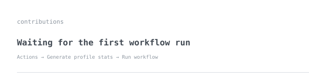
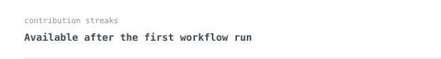
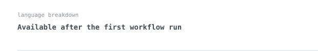
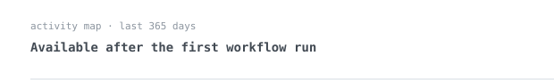

[warriorog.in](https://warriorog.in) &nbsp;·&nbsp;
[github](https://github.com/WarriorOGZz) &nbsp;·&nbsp;
[discord](https://discord.com/users/1250685386666016789)

> Developer focused on purposeful software, minimal architecture, and considered UI.

I build full-stack web experiences, developer tools, and Discord-focused projects. My work moves between React and TypeScript interfaces, Node.js services, automation, and Linux-based infrastructure. I care about software that feels polished on the surface and stays understandable underneath.

<samp>typescript &nbsp; javascript &nbsp; react &nbsp; next.js &nbsp; vite &nbsp; node.js &nbsp; discord.js &nbsp; python &nbsp; docker &nbsp; linux &nbsp; git &nbsp; postgresql &nbsp; mongodb</samp>

**[Premium-Portfolio-Page](https://github.com/WarriorOGZz/Premium-Portfolio-Page)** &nbsp;·&nbsp; <samp>react, typescript, vite</samp> 
A cyber-inspired developer portfolio built around clean component architecture, motion, and a responsive design system. [Live demo](https://premium-portfolio-page.vercel.app).

**[WarriorOG-Glassmorphism-Landing-Page](https://github.com/WarriorOGZz/WarriorOG-Glassmorphism-Landing-Page)** &nbsp;·&nbsp; <samp>react, typescript, gsap</samp> 
A cinematic portfolio concept using glassmorphism, layered visuals, animated typography, and interactive project sections.

**[Nocte-Premium](https://github.com/WarriorOGZz/Nocte-Premium)** &nbsp;·&nbsp; <samp>html</samp> 
A lightweight standalone interface experiment exploring a more minimal premium look.

No third-party stats widgets. The contribution graphics are generated by the scripts in this repository using GitHub's GraphQL API and the built-in Actions token, then refreshed daily.

After uploading these files to your profile repository, open **Actions → Generate profile stats → Run workflow** once. The temporary stats placeholders will be replaced with your account's own contribution and language data.

The portrait is an animated ASCII rendering of the original image in [`assets/warriorog-logo.jpg`](./assets/warriorog-logo.jpg). The source image is kept in the repository in case you want to regenerate or replace it later.
